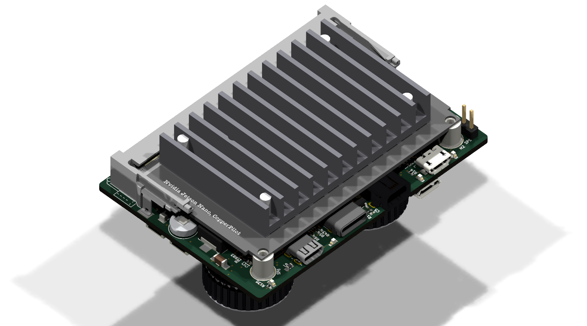
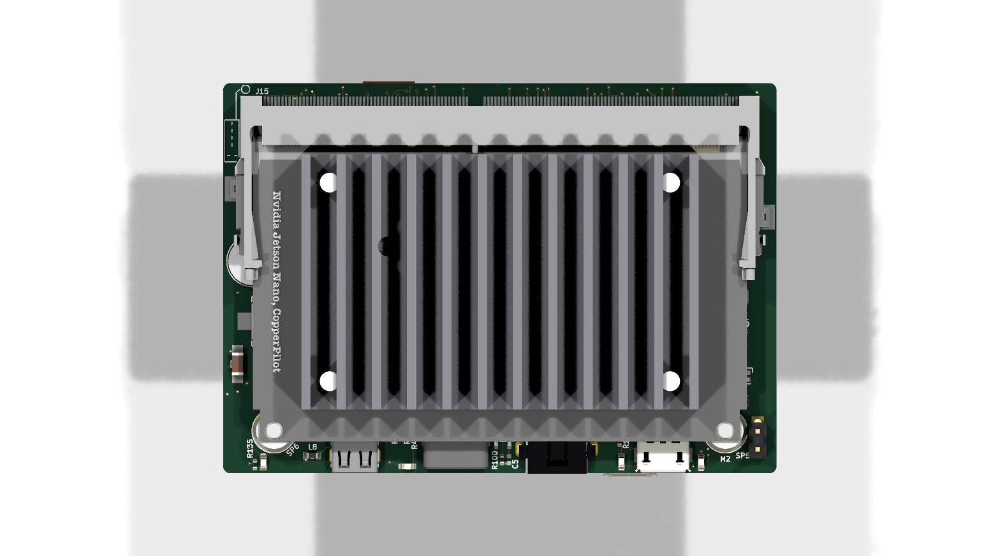
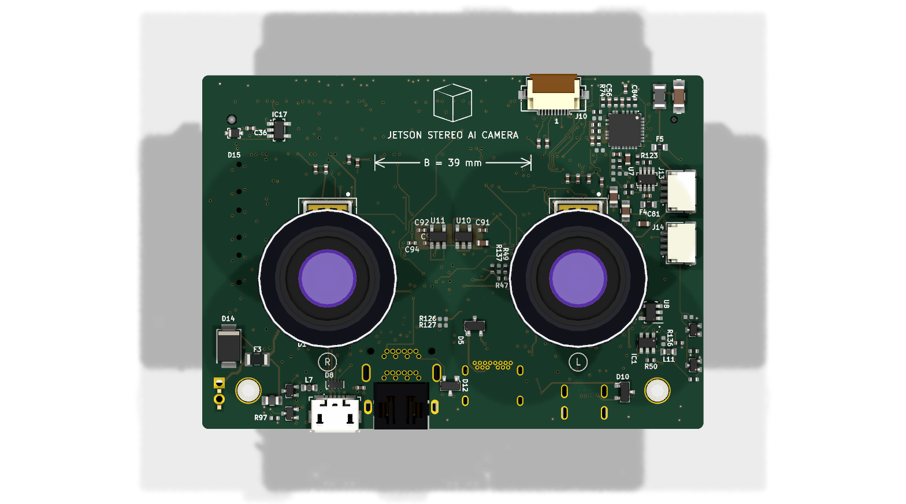

# Jetson Stereo AI Camera: 8-Layer High-Density Carrier Board

[](Jetson-AI-Cam-CopperPilot.kicad_pro)
[](Jetson-AI-Cam-CopperPilot.kicad_pcb)
[](Jetson-AI-Cam-CopperPilot.kicad_sch)
[](#8-layer-stackup--controlled-impedance)
[](manufacturing/ORDER_SPEC.md)
[-success.svg)](review/index.html)

An open-source, production-grade 8-layer carrier board for NVIDIA Jetson Nano, Xavier NX, and TX2 NX System-on-Modules (SoM). Engineered specifically for autonomous robotics, stereoscopic depth perception, and edge AI vision workloads, this carrier integrates dual on-board Sony IMX219 camera sensors (39.00 mm optical baseline with industrial M12 lens mounts), dual 4K display outputs (Mini DisplayPort and Micro-HDMI), USB 3.0 Type-C, dedicated USB-to-UART debugging, a CAN bus vehicle telemetry interface, and high-efficiency power delivery in an ultra-compact 82.26 mm x 55.00 mm form factor.

---

## 3D Hardware Overview

<p align="center">
  <br/>
  <em>Figure 1: Complete 3D CAD visualization showing SODIMM-260 module socket, dual on-board IMX219 stereo camera sensors (B.Cu), CAN bus interface, dual display ports, and USB-C power delivery.</em>
</p>

<p align="center">
  
  <br/>
  <em>Figure 2: Component placement on Top (F.Cu) and Bottom (B.Cu) layers.</em>
</p>

---

## Design Lineage & Reference Comparison

This project takes its initial architectural inspiration and baseline reference from the open-source **Antmicro Jetson Nano Baseboard**. While the Antmicro board serves as an excellent general-purpose breakout for desktop evaluation, our team re-architected and engineered this board specifically for compact autonomous robotics, drones, and edge stereoscopic vision.

### Key Architectural Differences & Improvements

1. **Direct On-Board Stereo Camera Integration**:
   - *Reference Board:* Required external camera breakout modules connected via fragile, high-noise flexible flat cables (FFC).
   - *Our Design:* Integrates dual Sony IMX219 image sensors (`CAM_L` and `CAM_R`) directly onto the bottom layer (B.Cu) with a precision **39.00 mm stereoscopic baseline** (`B = 39 mm`) and standard M12 lens assemblies. This eliminates ribbon cable vibration artifacts, reduces electromagnetic radiation, and provides a rigid optical alignment.

2. **Dedicated Low-Noise Camera Power Architecture**:
   - *Reference Board:* Shared auxiliary power rails across multiple peripherals.
   - *Our Design:* Implements dedicated ultra-low-noise linear regulators specifically for camera imaging:
     - **TI TLV75512** (U11) providing a dedicated 1.2V core rail.
     - **TI TPS7A0528** (U10) delivering a clean 2.8V analog sensor rail.
     - **TI TPS7A0518** (IC4, IC15) supplying 1.8V digital I/O.
     - Localized low-inductance ground return shields and bypass capacitor banks placed directly under each sensor footprint on B.Cu to suppress high-frequency switching noise.

3. **SWaP Optimization for Robotics (Size, Weight, and Power)**:
   - *Reference Board:* Included a bulky Bel RJ45 Gigabit Ethernet jack and a full-size 2280 M.2 Key M NVMe SSD socket.
   - *Our Design:* Removed the heavy RJ45 magnetics and M.2 slot to dramatically reduce overall board mass, component height profile, and quiescent power consumption, matching the stringent SWaP budgets of unmanned aerial vehicles (UAVs) and mobile robotics.

4. **Integrated CAN Bus for Vehicle Telemetry**:
   - *Reference Board:* Lacked a native CAN physical layer transceiver.
   - *Our Design:* Integrates an on-board **Maxim MAX3051EKA** CAN bus transceiver (U7) with PTC fuse protection, 120 Ω bus termination, and dual locking JST SH 1x4 headers (J13, J14), enabling direct telemetry communication with flight controllers, motor drivers, and industrial automation networks.

5. **Upgraded Power Delivery Stage**:
   - *Reference Board:* Standard 5V step-down regulator.
   - *Our Design:* Upgraded to a high-efficiency **Vishay SiC477** (U6) synchronous buck converter capable of delivering up to 6.0 A continuous output at 5.0 V (`5V0_SYS`), paired with a secondary **LM3671** (U1) synchronous buck converter for 3.3 V system logic and power path sequencing.

6. **Automated Verification & Manufacturing Compliance (DFM)**:
   - *Reference Board:* Basic design rules without automated test harnesses.
   - *Our Design:* Engineered strictly to JLCPCB 8-layer high-density interconnect (HDI) manufacturing capabilities with 100% routing completion, zero DRC errors, zero ERC warnings, an automated 21-point PyTest verification suite, and an 11-point acceptance test pipeline (`review/verify.sh`).

---

## System Architecture

```
                                +---------------------------------------------+
                                |             DC Power Input                  |
                                |   2-Pin Header (J4) / USB-C VBUS (5-24V)    |
                                +----------------------+----------------------+
                                                       |
                                            +----------v----------+
                                            |  Vishay SiC477 Buck |
                                            | 5.0V / 6.0A SYS_VIN |
                                            +----+-----------+----+
                                                 |           |
                              +------------------+           +------------------+
                              |                                                 |
                   +----------v----------+                           +----------v----------+
                   |  LM3671 Buck Conv.  |                           | TLV75512 / TPS7A05  |
                   |   3.3V / 1.0A Rail  |                           | Camera LDOs (1.2/2.8)|
                   +----------+----------+                           +----------+----------+
                              |                                                 |
+-----------------------------v-------------------------------------------------v-----------------------------+
|                                    NVIDIA Jetson SoM (260-Pin SODIMM Socket)                                |
|                                       Nano / Xavier NX / TX2 NX Series                                      |
+-----------------+-----------------------+----------------------+-----------------------+--------------------+
                  |                       |                      |                       |
       MIPI CSI-2 | (2x 2-Lane Direct)    | CAN 2.0B / Telemetry | DP 1.2 Video Output   | HDMI 2.0 Output
                  v                       v                      v                       v
+-----------------+----+   +--------------+----+   +-------------+----+   +--------------+----+
| Dual Sony IMX219     |   | Maxim MAX3051EKA  |   | TE 2129320-3     |   | Molex 467651001   |
| Stereo Sensors       |   | CAN Transceiver   |   | Mini DisplayPort |   | Micro-HDMI Port   |
| (39mm Baseline, B.Cu)|   | (Dual JST SH 1x4) |   | (TPD8S009 ESD)   |   | (TPD8S009 ESD)    |
+----------------------+   +-------------------+   +------------------+   +-------------------+
                  |                       |                      |
                  v                       v                      v
        +---------+------------+  +-------+------------+  +------+-------------+
        | USB 3.0 Type-C Port  |  | Micro-B Debug UART |  | RTC Battery Backup |
        | HD3SS3220 DFP / CC   |  | FT232RQ USB Bridge |  | Seiko MS621FE Cell |
        +----------------------+  +--------------------+  +--------------------+
```

---

## Key Hardware Features

- **Form Factor & Module Compatibility**: Standard 82.26 mm x 55.00 mm form factor, fully compatible with NVIDIA Jetson Nano, Xavier NX, and TX2 NX production modules via a TE Connectivity 2309413-1 260-pin SODIMM connector.
- **Stereoscopic AI Vision**: Dual on-board Sony IMX219 image sensors directly soldered on the bottom layer (B.Cu) with an exact 39.00 mm optical baseline, compatible with standard M12 lens holders, hardware synchronization, and independent I2C bus address switching via an NXP PCA9547 multiplexer.
- **Low-Noise Camera Power Delivery**: Independent low-dropout regulators (TI TLV75512 for 1.2V core, TI TPS7A0528 for 2.8V analog, TI TPS7A0518 for 1.8V digital) with localized ferrite bead filtering and decoupling capacitor arrays.
- **Dual 4K Display Outputs**: Native Mini DisplayPort (mDP) and Micro-HDMI receptacles equipped with Texas Instruments TPD8S009 multi-channel ESD protection arrays and level-shifted I2C DDC lines.
- **Vehicle Telemetry Interface**: On-board CAN bus subsystem driven by a Maxim MAX3051EKA transceiver with dual JST SH 1x4 daisy-chain headers and switchable termination.
- **Industrial Power Supply**: Vishay SiC477 synchronous step-down converter providing stable 5.0 V @ 6.0 A to the compute module from input voltages spanning 5.5 V to 24 V.
- **USB & Debugging Subsystem**: Würth Elektronik USB-C receptacle with TI HD3SS3220 DFP/CC controller, dedicated Micro-B USB port connected to an FTDI FT232RQ UART bridge for bootloader telemetry and kernel console access, status LEDs, and reset/recovery buttons.

---

## 8-Layer Stackup & Controlled Impedance

The PCB utilizes a symmetrical 8-layer stackup with two solid, continuous internal ground planes (In4_GND and In6_GND) to guarantee low return-loop inductance, robust EMI immunity, and tight impedance control across all high-speed differential and single-ended signals.

| Layer | Type | Copper Weight | Thickness | Material / Function |
| :--- | :--- | :--- | :--- | :--- |
| **F.SilkS** | Silkscreen | - | - | Top Silkscreen Legend |
| **F.Mask** | Solder Mask | - | 0.010 mm | High-TG Soldermask (Green) |
| **F.Cu (L1)** | Signal | 1.0 oz (35 µm) | 0.035 mm | RF, High-Speed Differential Pairs, USB 3.0 |
| *Dielectric 1*| Prepreg | - | 0.099 mm | FR4-3313 (εr = 4.05) |
| **In1.Cu (L2)**| Power/Signal | 0.5 oz (15 µm) | 0.015 mm | 5V0_SYS_VIN Power Plane |
| *Dielectric 2*| Core | - | 0.200 mm | FR4 (εr = 4.60) |
| **In2.Cu (L3)**| Signal | 0.5 oz (15 µm) | 0.015 mm | High-Speed Internal Signals & Camera Clocks |
| *Dielectric 3*| Prepreg | - | 0.200 mm | FR4-2116 (εr = 4.16) |
| **In3.Cu (L4)**| Signal | 0.5 oz (15 µm) | 0.015 mm | DisplayPort Main Link & HDMI TMDS Routing |
| *Dielectric 4*| Core | - | 0.450 mm | FR4 (εr = 4.60) Center Core |
| **In4.Cu (L5)**| Ground Plane | 0.5 oz (15 µm) | 0.015 mm | Continuous Solid GND Reference Plane |
| *Dielectric 5*| Prepreg | - | 0.200 mm | FR4-2116 (εr = 4.16) |
| **In5.Cu (L6)**| Power/Signal | 0.5 oz (15 µm) | 0.015 mm | 3V3_SYS Power Plane & Low-Speed Control |
| *Dielectric 6*| Core | - | 0.200 mm | FR4 (εr = 4.60) |
| **In6.Cu (L7)**| Ground Plane | 0.5 oz (15 µm) | 0.015 mm | Continuous Solid GND Reference Plane |
| *Dielectric 7*| Prepreg | - | 0.099 mm | FR4-3313 (εr = 4.05) |
| **B.Cu (L8)** | Signal | 1.0 oz (35 µm) | 0.035 mm | MIPI CSI-2 Differential Pairs, Decoupling, Sensor Pours |
| **B.Mask** | Solder Mask | - | 0.010 mm | High-TG Soldermask (Green) |
| **B.SilkS** | Silkscreen | - | - | Bottom Silkscreen Legend |

*Total finished board thickness: 1.61 mm ± 10% (JLCPCB JLC08161H-3313 / 7628 impedance standard).*

### Controlled-Impedance Net Classes

- **Differential 100 Ω**: MIPI CSI-2 camera data and clock lanes (`CAM0_*`, `CAM1_*`), DisplayPort Main Link pairs, HDMI TMDS differential pairs.
- **Differential 90 Ω**: USB 2.0 High-Speed and USB 3.0 SuperSpeed data pairs (`USB_D+`/`USB_D-`, `SS_TX_P`/`SS_TX_N`, `SS_RX_P`/`SS_RX_N`).
- **Single-Ended 50 Ω**: High-speed digital reference clocks, UART debug lines, and single-ended high-frequency control signals.

---

## JLCPCB DFM & Capability Compliance

All copper geometries, hole sizes, and clearances adhere strictly to JLCPCB Multilayer manufacturing capabilities:

| Constraint | JLCPCB Multilayer Floor | Board Implementation | Margin | Status |
| :--- | :--- | :--- | :--- | :--- |
| **Track Width** | 0.090 mm (3.5 mil) | **≥ 0.127 mm** (fine pitch) / **0.150 mm** (std) | **+41% to +66%** | Verified |
| **Trace-to-Trace Spacing** | 0.090 mm (3.5 mil) | **≥ 0.150 mm** (6.0 mil) | **+66%** | Verified |
| **Through Via Drill / Diameter** | 0.150 / 0.250 mm | **0.300 / 0.600 mm** (0.15 mm annular ring) | **+100% / +140%** | Verified |
| **Microvia Drill / Diameter** | 0.100 mm drill | **0.100 mm drill / 0.250 mm pad** | Standard HDI | Verified |
| **Copper to Board Edge** | 0.200 mm | **≥ 0.350 mm** | **+75%** | Verified |
| **Solder Mask Dam** | 0.100 mm | **≥ 0.120 mm** | **+20%** | Verified |
| **Silkscreen Text Height** | 0.800 mm | **1.000 mm** standard | **+25%** | Verified |
| **Silkscreen Min Line Width** | 0.150 mm | **0.150 mm** | Compliant | Verified |

---

## Repository Structure

```
.
├── Makefile                        # Unified build, test, lint, and verification runner
├── .gitignore                      # Clean exclusion rules (ignores caches, temporaries, and internal logs)
├── LICENSE                         # CERN Open Hardware Licence v2 - Permissive (CERN-OHL-P)
├── README.md                       # Technical overview, usage instructions, and hardware documentation
├── Jetson-AI-Cam-CopperPilot.kicad_pro  # KiCad 10 project settings, netclasses, and stackup
├── Jetson-AI-Cam-CopperPilot.kicad_sch  # Top-level hierarchical schematic sheet
├── Jetson-AI-Cam-CopperPilot.kicad_pcb  # 8-layer board layout (100% routed, 0 DRC violations)
├── Jetson-AI-Cam-CopperPilot.kicad_dru  # Custom KiCad design rules
├── csi.kicad_sch                   # Subsheet: Dual IMX219 stereo cameras, LDOs, & I2C switch
├── display.kicad_sch               # Subsheet: Mini DisplayPort & Micro-HDMI video pipelines
├── id-serial.kicad_sch             # Subsheet: Board ID EEPROM, strapping, status LEDs, RTC cell
├── interfaces.kicad_sch            # Subsheet: CAN bus transceiver (MAX3051EKA) & expansion ports
├── som.kicad_sch                   # Subsheet: Jetson 260-pin SODIMM connector & module power control
├── supply.kicad_sch                # Subsheet: SiC477 5V buck converter & LM3671 3.3V regulators
├── usb-debug.kicad_sch             # Subsheet: USB 3.0 Type-C & FT232RQ debug UART interface
├── fp-lib-table                    # Project-local footprint library table (${KIPRJMOD})
├── sym-lib-table                   # Project-local symbol library table (${KIPRJMOD})
├── libs/                           # Local symbol definitions (.kicad_sym)
├── jetson-footprints.pretty/       # Local footprint definitions (.kicad_mod)
├── 3dmodels/                       # Self-contained STEP and WRL 3D CAD models
├── docs/                           # High-resolution documentation assets and 3D renders
├── manufacturing/                  # Ready-to-order fabrication & assembly deliverables
│   ├── gerbers.zip                 # RS-274X Gerber & Excellon drill release archive
│   ├── BOM.csv                     # Complete Bill of Materials with LCSC part numbers
│   ├── CPL.csv                     # Pick-and-place centroid component placement list
│   ├── Jetson-AI-Cam-CopperPilot.d356 # IPC-D-356 electrical test netlist
│   └── ORDER_SPEC.md               # JLCPCB order parameters and configuration sheet
├── review/                         # Comprehensive engineering audit & verification suite
│   ├── index.html                  # Self-contained visual diff and engineering sign-off report
│   ├── verify.sh                   # Automated 11-point acceptance test script
│   ├── verify-report.json          # Machine-readable test execution report
│   ├── ISSUES.md                   # Resolved issue register and engineering remediations
│   └── DECISIONS.md                # Engineering trade-offs, rationale, and waiver justifications
└── tests/                          # Automated PyTest hardware verification suite
    ├── conftest.py                 # KiCad S-expression AST parsers and test fixtures
    └── test_pcb.py                 # Hardware verification tests (stackup, DFM, connectivity)
```

---

## Instructions for Use

### 1. Opening the Project in KiCad

This project is authored in **KiCad 10** and is fully backward-compatible with **KiCad 9**. All symbol and footprint libraries are entirely self-contained within the repository and use `${KIPRJMOD}` project-relative paths.

1. Clone the repository:
   ```bash
   git clone https://github.com/<owner>/Jetson-AI-Cam.git
   cd Jetson-AI-Cam
   ```
2. Open `Jetson-AI-Cam-CopperPilot.kicad_pro` in KiCad:
   - Double-click the `.kicad_pro` file or launch via KiCad: `File -> Open Project`.
   - Open the Schematic Editor (`Jetson-AI-Cam-CopperPilot.kicad_sch`) to view the hierarchical schematics.
   - Open the PCB Editor (`Jetson-AI-Cam-CopperPilot.kicad_pcb`) to inspect the layout, stackup, and 3D CAD visualization (`View -> 3D Viewer`).

### 2. Automated Verification & Testing

The repository includes a complete verification pipeline verifying electrical rule checks (ERC), design rule checks (DRC), manufacturing constraints, and physical geometries.

```bash
# Run the complete test suite (21-point PyTest suite + 11-point acceptance tests)
make test

# Run only the automated PyTest hardware verification suite
make test-pcb

# Run the official 11-point acceptance verification script
make verify

# Run KiCad CLI Electrical Rule Check (ERC)
make erc

# Run KiCad CLI Design Rule Check (DRC) with zone refilling
make drc

# Verify manufacturing deliverables (Gerbers, BOM, CPL, ORDER_SPEC)
make fab

# Clean test caches and temporary outputs
make clean
```

### Acceptance Test Suite Coverage (`review/verify.sh`)

| Test ID | Verification Target | Pass Condition | Result |
| :--- | :--- | :--- | :--- |
| **T1** | Schematic ERC | 0 Errors, 0 Warnings, 0 Unapproved Exclusions | **PASS** |
| **T2** | Layout DRC | 0 Errors, 0 Warnings, 0 Unconnected, 0 Parity Mismatches | **PASS** |
| **T3** | JLCPCB Rules | All design rules meet or exceed target thresholds | **PASS** |
| **T4** | Rule Integrity | No constraints loosened compared to baseline | **PASS** |
| **T5** | Severity Levels | No checks downgraded from error/warning to ignore | **PASS** |
| **T6** | BOM Completeness | 100% of SMT components have Value, Footprint, MPN, and LCSC # | **PASS** |
| **T7** | Manufacturing Outputs | Complete Gerbers, Excellon NC drills, BOM, and CPL generated | **PASS** |
| **T8** | Issue Register | All 10 engineering issues resolved and closed | **PASS** |
| **T9** | Visual Evidence | Every non-waived issue has deterministic before/after/diff crops | **PASS** |
| **T10** | Parity & Visual Diff | Zero unexplained visual changes across all sheets and layers | **PASS** |
| **T11** | Repository Hygiene | Project-local paths only, clean git tree, no cached artifacts | **PASS** |

For interactive visual layer diffs and audit logs, open `review/index.html` in any web browser.

---

## Manufacturing & Ordering Guide

Production files are pre-generated and located under `manufacturing/`:

1. **Fabrication (Gerbers & Drills)**:
   - Upload `manufacturing/gerbers.zip` directly to [JLCPCB](https://jlcpcb.com).
   - Set parameters according to `manufacturing/ORDER_SPEC.md`:
     - **Layers:** 8
     - **Dimensions:** 82.26 mm x 55.00 mm
     - **Stackup:** `JLC08161H-3313` (Standard 8-layer controlled impedance)
     - **Surface Finish:** ENIG (Electroless Nickel Immersion Gold)
     - **Solder Mask:** Green (or preferred color)
     - **Via Covering:** Tented

2. **SMT Assembly (PCBA)**:
   - Enable **Standard PCBA** with dual-sided assembly.
   - Upload `manufacturing/BOM.csv` for parts list (100% mapped with LCSC part numbers).
   - Upload `manufacturing/CPL.csv` for centroid pick-and-place component coordinates.

3. **Electrical Continuity Testing**:
   - Provide `manufacturing/Jetson-AI-Cam-CopperPilot.d356` for flying-probe electrical test verification.

---

## License

This project is licensed under the **CERN Open Hardware Licence Version 2 - Permissive (CERN-OHL-P)**. See the [LICENSE](LICENSE) file for complete license terms.
